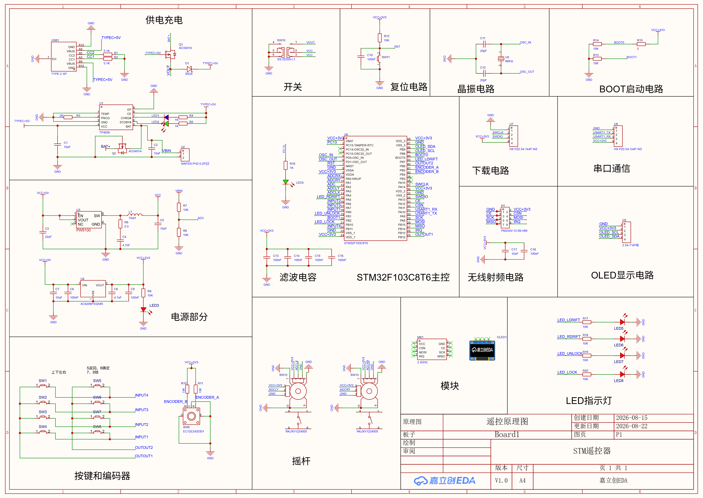
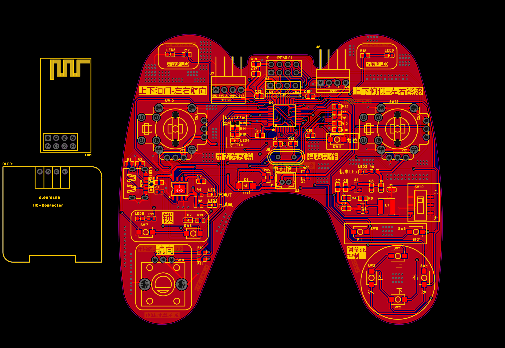
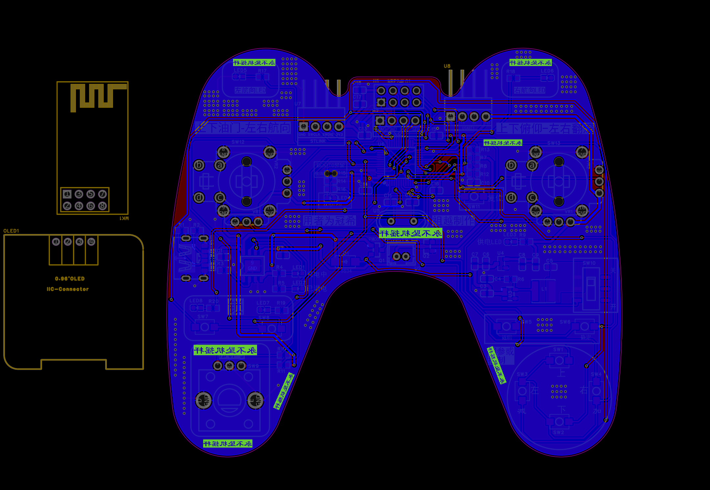
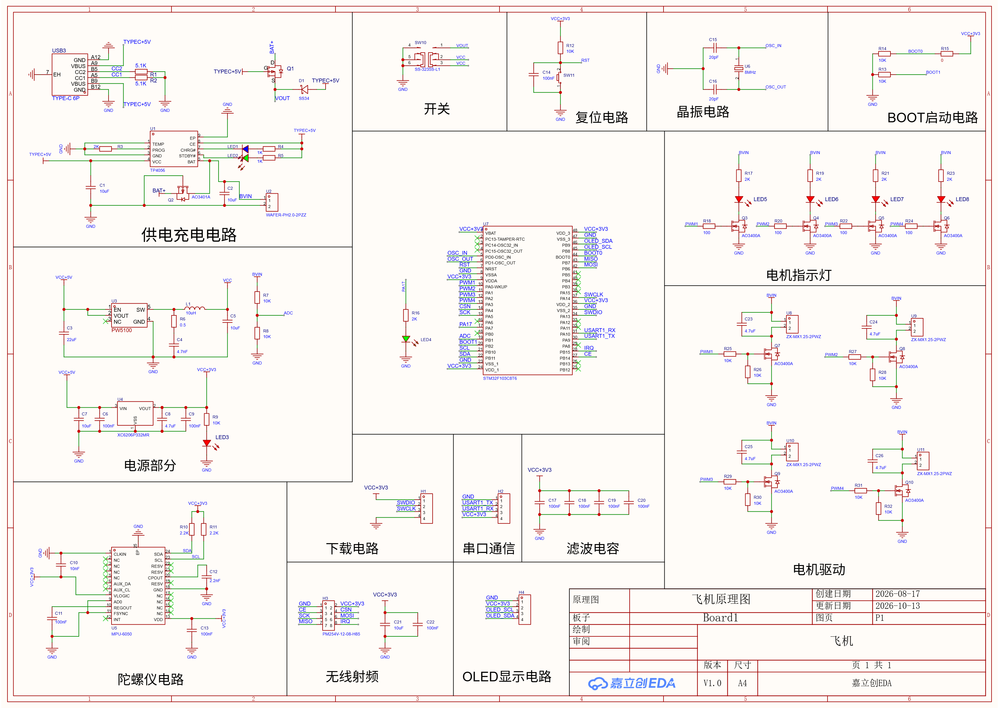
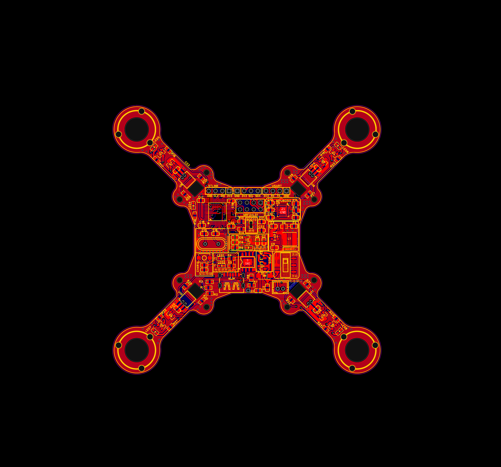
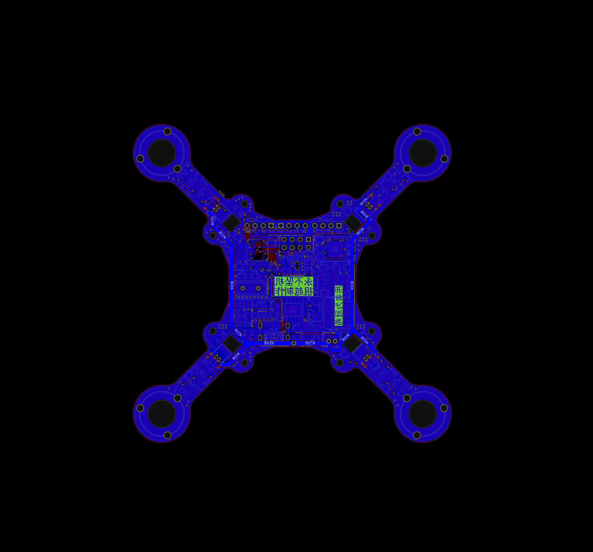

# STM32 空心杯四轴飞控与遥控系统

基于开源工程重构的双端系统：**遥控端 + 飞控端**，两端主控均为 STM32F103C8T6，
通过 nRF24L01 2.4G 无线链路通信。

工作内容为**工程重构与硬件重新设计**，而非从零编写——原工程关系见下方说明。

---

## 项目状态

> 硬件设计与软件重构已完成，**PCBA 焊接与整机联调进行中**。
> PID 参数当前沿用原工程初值，待硬件联调后自行整定。

| 模块 | 状态 |
|---|---|
| 原理图与双层 PCB 重画、投板 | ✅ 已完成（2026-10-13 修订版） |
| SPL → CubeMX + HAL 重构 | ✅ 已完成 |
| DMP 姿态解算库移植 | ✅ 已完成 |
| 位置式串级 PID 闭环 + 四电机混控 | ✅ 已完成 |
| 软件模拟 SPI（nRF24L01） | ✅ 已完成 |
| 微秒延时实现（DWT → 空循环，原因见下） | ✅ 已完成 |
| 寄存器配置核对（依数据手册） | ✅ 已完成 |
| nRF24L01 双端通信 | ✅ 已打通（遥控端 OLED 显示链路状态） |
| 电池电压检测 | ❌ 本版 PCBA 已禁用（原因见下） |
| PCBA 焊接 | ⬜ 待进行 |
| 整机联调 | ⬜ 待进行 |
| PID 参数整定 | ⬜ 待进行 |

---

## 系统结构

```
        遥控端 (Controller)                   飞控端 (FlightControl)
  ┌──────────────────────────┐          ┌──────────────────────────┐
  │  STM32F103C8T6 @72MHz    │          │  STM32F103C8T6 @72MHz    │
  │                          │          │                          │
  │  双摇杆 ADC 采集          │          │  MPU6050 姿态采集         │
  │  按键矩阵 / 编码器        │  nRF24   │  DMP 姿态解算             │
  │  OLED 状态显示            │ ◄──────► │  串级 PID 闭环            │
  │  电池电压监测             │  2.4G    │  四路电机 PWM 混控 (20kHz)│
  │                          │          │  OLED 参数配置界面        │
  └──────────────────────────┘          └──────────────────────────┘
```

---

## 硬件

| 项 | 参数 |
|---|---|
| 主控 | STM32F103C8T6（64KB Flash / 20KB RAM，LQFP48）×2 |
| 系统时钟 | HSE 8MHz × PLL9 = 72MHz；APB1 36MHz / APB2 72MHz |
| 姿态传感器 | MPU6050（软件 I2C） |
| 无线通信 | nRF24L01（软件模拟 SPI，2.4G） |
| 显示 | SSD1306 OLED |
| 电机驱动 | 四路空心杯电机，TIM2 四通道 PWM，20kHz |
| 状态指示 | LED，当前用作 nRF24L01 链路指示（原低电指示已弃用） |
| 电池检测 | 已投板 PCBA 的分压网络存在网络标签错误，本版由软件禁用 |
| 调试接口 | SWD（PA13 / PA14） |
| PCB | 双层板，嘉立创 EDA 绘制，已投板（2026-10-13 修订原理图与 PCB） |

---

## 原理图和 PCB 图

原理图与 PCB 均为本次重画，已投板打样。图片为嘉立创 EDA 导出的原始设计文件截图。

### 遥控端

**原理图**



**PCB 顶层**



**PCB 底层**



### 飞控端

原理图按功能块分区绘制：供电充电、电源（升压 + 3.3V LDO）、陀螺仪、电机驱动、
无线射频、OLED 显示、下载与串口。

**原理图**



**PCB 顶层**



**PCB 底层**



---

## 本次完成的技术工作

### 1. 工程重构：SPL → CubeMX + HAL

原工程基于标准外设库（SPL），逐驱动提取引脚与外设配置后，用 CubeMX 重建为 HAL 工程，
引脚、时钟、外设与原版逐项对齐。完整配置见仓库中的 `.ioc` 文件，可用 STM32CubeMX 直接打开查看。

### 2. 逆向分析原工程，梳理通信协议

原工程无文档，通过逐行阅读驱动源码提取：完整引脚映射表、nRF24L01 的寄存器配置与
无线通信协议、四电机混控的通道对应关系。

### 3. 移植 InvenSense DMP 姿态解算库

将 MPU6050 的 DMP 库（`inv_mpu.c` / `inv_mpu_dmp_motion_driver.c`）移植到 HAL 环境，
免去自行实现姿态融合算法。

### 4. 实现位置式串级 PID 与四电机混控

角度环 + 角速度环的串级 PID 闭环控制，输出经混控分配至四路电机 PWM。

### 5. 微秒延时的实现与取舍

**起点**：原工程用 SysTick 实现 µs 级延时，与 HAL 的 1ms 系统时基（同样占用 SysTick）
冲突，导致延时失准。

**第一步方案**：改用 Cortex-M3 内核的 **DWT（Data Watchpoint and Trace）周期计数器**。
它独立于 SysTick，理论上精度更高。

**实际遇到的问题**：DWT 的 `CYCCNT` 在 **未连接调试器时不会递增**，
`while(DWT->CYCCNT - start < us_ticks);` 会变成死循环，程序直接卡死。

**最终方案**：改用**经校准的空循环**实现 µs 延时（72MHz 下约 15 次 NOP / µs）。

**取舍说明**：空循环的耗时理论上会受编译器优化等级影响，可靠性不如硬件计数器；
但 nRF24L01 的软件 SPI 时序要求并不苛刻，实测稳定。
真正的教训是——**硬件计数器不是无条件可用的**，它的前提条件（调试器连接）
在最终产品上并不成立，这一点在选型时就要考虑到。

### 6. 软件模拟 SPI 方案论证

**问题**：nRF24L01 所需的 SCK / IRQ 引脚与硬件 SPI 的复用引脚不匹配。

**方案**：论证后放弃硬件 SPI，改用 GPIO 软件模拟 SPI 时序，并据此重新分配引脚。

### 7. 用软件规避已投板 PCBA 的硬件缺陷

**现象**：飞控端状态灯长期处于"低电快闪"状态，链路指示功能完全失效；
串口打印的电池电压始终接近 0。

**定位过程**：先怀疑 ADC 配置，加上 `HAL_ADCEx_Calibration_Start()` 后读数仍无变化；
再核对原理图，发现**电源分压网络的上端网络标签写错了**——
R7 上端本应接到 `BVIN`（电池电压），实际却标成了不存在的 `VBIN`，
导致 R7 一端悬空，分压电路没有回路，ADC 通道永远读到接近 0 的值。

**连锁影响**：电池电压恒为 0 → `Battery_Protect` 长期置 1 →
状态灯被"低电快闪"逻辑独占 → nRF24L01 链路指示功能一并失效。

**决策**：板子已经打样，**重新走一遍改图、打样、贴片、焊接的成本太高**，
而这个缺陷影响的只是"电池电压检测"这一项非核心功能。因此选择在软件上规避，
而不是重新投板。修改后的原理图（R7 上端已修正为 `BVIN`）已随本仓库更新，
可用于下一版打样。

**软件侧处理**：

1. 电池检测增加下限判断，读数低于 0.5V 视为"未接入分压网络"而非低电：

   ```c
   if(Battery_average > 0.5f && Battery_average <= 3.5f) Battery_Protect = 1;
   ```

2. **把状态灯的功能重新分配**——既然低电告警已无意义，就把它让出来做更有价值的事：
   状态灯改为指示 **nRF24L01 链路状态**。遥控端 OLED 同步显示
   `S:OK`（已联通）/ `S:<状态码>`（未收到应答），两端都能直观判断无线链路是否正常。

**这一步的意义**：板子有缺陷不等于项目失败。识别出"哪些功能受影响、哪些不受影响"，
再决定"修硬件还是改软件"，这个判断本身就是工程能力的一部分。
而且**被让出来的状态灯反而承担了更重要的职责**——链路指示对联调阶段的价值
高于电池电压显示。

### 8. 调试过程中定位并修复的其他问题

| 问题 | 根因 | 处理 |
|---|---|---|
| 遥控端发不出数据 | `NRF24L01_WriteBuf(W_REGISTER+W_TX_PAYLOAD, ...)`——`W_TX_PAYLOAD`(0xA0) 已是完整命令，再叠加 `W_REGISTER`(0x20) 会写到错误寄存器 | 改为直接传 `W_TX_PAYLOAD` |
| 遥控端发送时可能卡死 | 等待 IRQ 的 `while` 无超时，对端未就绪时死等 | 增加约 10ms 超时退出 |
| 飞控周期任务永久漏触发 | 计数器与目标值用 `==` 比较，一旦越过就再也不会相等 | 改为 `>=` 比较，并抽出 `PERIOD_*` 常量 |
| 状态灯闪烁卡死约 65 秒 | 闪烁速率从 500ms 切到 50ms 时，旧计数值已大于新周期，`==` 比较需等计数器溢出才会翻转 | 计数改 `>=`，并在速率变化时重置计数 |
| 电机转速在 0 与 1000 之间乱跳 | 主循环直接写电机比较值，与 1ms 中断里的 `Motor_Control()` **争用同一组 CCR 寄存器** | 电机 PWM 只由中断写，主循环不再操作 |
| ADC 读数偏差大 | STM32F1 的 ADC 上电后必须执行校准 | 增加 `HAL_ADCEx_Calibration_Start()` |
| nRF24L01 接收判据依赖 IRQ 连线 | 直接读 IRQ 引脚，对硬件连线有依赖 | 改为轮询 `STATUS` 寄存器的 `RX_OK` 位 |
| 飞控 `Data_proc.c` 参数下发解析 | 遥控端新增 PID 参数下发通道，需同步补上解析 | 补充解析逻辑与 `Variable.h` 中的诊断变量声明 |

### 9. 其他

- 按数据手册核对并配置 MPU6050、nRF24L01 各寄存器
- 清理原工程死代码
- 解决源文件混合编码问题（GB2312 / UTF-8 混杂），统一为 UTF-8 并验证编译通过

---

## 目录结构

```
.
├── Controller/              遥控端工程
│   ├── Core/
│   │   ├── Inc/             外设与业务头文件
│   │   └── Src/             外设驱动与主逻辑
│   │       ├── main.c
│   │       ├── MySPI.c      nRF24L01 软件模拟 SPI
│   │       ├── NRF24L01.c   无线通信
│   │       ├── Data_proc.c  数据处理与协议解析
│   │       ├── Delay.c      微秒延时（空循环实现）
│   │       ├── Key.c        按键矩阵
│   │       ├── adc.c        摇杆与电池电压采集
│   │       └── OLED.c       显示驱动
│   ├── MDK-ARM/             Keil 工程（.uvprojx）
│   └── Controller.ioc       CubeMX 配置
│
├── FlightControl/           飞控端工程
│   ├── Core/
│   │   ├── Inc/
│   │   └── Src/
│   │       ├── main.c
│   │       ├── Data_proc.c  姿态解算与串级 PID
│   │       ├── Motor.c      四电机混控输出
│   │       ├── PWM.c        20kHz PWM 输出
│   │       ├── mpu6050.c    姿态传感器
│   │       ├── MyI2C.c      软件模拟 I2C
│   │       ├── inv_mpu.c    DMP 姿态解算库（移植）
│   │       ├── NRF24L01.c   无线通信
│   │       ├── PowerDetection.c  电池电压检测
│   │       └── Delay.c      DWT 微秒延时
│   ├── Drivers/             STM32F1 HAL 库与 CMSIS
│   ├── MDK-ARM/
│   └── Flight Control.ioc
```

---

## 编译与烧录

**工具链**：Keil µVision 5（MDK-ARM V5），器件包 STM32F1xx_DFP

```
1. 打开 Controller/MDK-ARM/Controller.uvprojx
   或 FlightControl/MDK-ARM/Flight Control.uvprojx
2. 确认 Device 选择 STM32F103C8
3. Build (F7)
4. 通过 SWD 烧录（ST-Link）
```

工程同时提供 `.ioc` 文件，可用 STM32CubeMX 打开修改配置。

---

## 与原工程的关系

本项目的**引脚定义、通信协议、控制结构框架**沿用原开源工程 ——
[STM32 空心杯四轴飞行器/无人机](https://oshwhub.com/sngelswyh/coreless-quadcopter)（立创开源硬件平台，作者 sngelswyh）。

本次工作为：工程重构（SPL→HAL）、外设重新配置、DMP 库移植、
延时方案重新设计（SysTick → DWT → 空循环）、软件 SPI 方案论证、
nRF24L01 通信链路调试、硬件重新设计（原理图与双层 PCB 重画，2026-10-13 修订）。

> 原工程基于标准外设库（SPL）开发，本仓库为其 HAL 重构版本，并非从零编写。
> 请以原工程作为原始设计参考。

参考资料：

- SSD1306 OLED 驱动的部分实现参考了网络上公开的 SSD1306 驱动代码，
  已按本项目的 HAL 环境与显示需求改写。

---

## 后续计划

1. PCBA 焊接
2. 单端上电点亮，验证电源、时钟、OLED 显示
3. 双端 nRF24L01 通信联调，验证无线链路可靠性
4. 电机 PWM 输出验证与混控方向核对
5. 串口输出姿态数据至上位机，观察阶跃响应曲线
6. 依据响应曲线整定串级 PID 参数
7. 试飞与调参记录

**下一版硬件（非本次打样）待办**：

- 飞控板电源分压网络已修正 R7 上端网络标签为 `BVIN`，下一版打样后
  可恢复电池电压检测功能，届时把状态灯的电池指示逻辑加回来

---

## 说明

- 本项目为个人学习项目，用于工程能力实践
- 仓库不含任何构建产物与第三方器件包缓存
- 焊接与联调完成后会更新本 README 的状态表与调参记录
